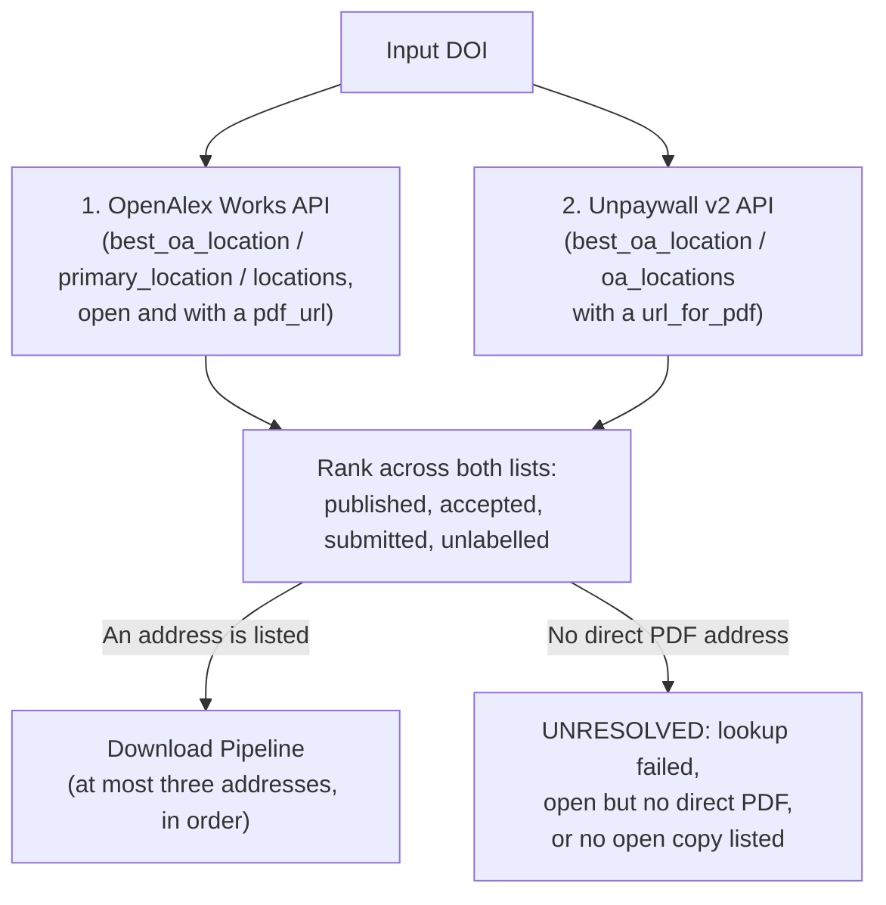

# Open Access Resolution & Download Mechanics

This reference details how `scholar-pdf-kit` resolves DOIs to legal Open Access PDFs, manages concurrent downloading, validates file integrity, and avoids publisher paywalls.

---

## 1. Multi-Stage OA Resolution

The toolkit asks both services for every DOI and takes the best open copy
either lists (`process_doi` in `src/scholar_pdf/downloader.py`, ranking in
`src/scholar_pdf/open_copies.py`):



1. **OpenAlex**: Queries `https://api.openalex.org/works/https://doi.org/{doi}` via the search-kit's httpx client, once. Every listed location is read (`best_oa_location`, `primary_location`, `locations`); one counts only if OpenAlex marks it open (`is_oa: true`) and it carries a direct `pdf_url`.
2. **Unpaywall**: Queries `https://api.unpaywall.org/v2/{doi}`, once, for every DOI (decision 2026-11-21, H-pdf-resolver-locations item 4, "Always ask both services"), and reads `best_oa_location` and `oa_locations` for a `url_for_pdf`.
   - **Ranking** (`scholar_pdf.open_copies.open_copies`; M12a answer F3): across both lists, published version, then accepted manuscript, then submitted version or preprint, then a copy with no version label; within a version OpenAlex's locations before Unpaywall's, each in its provider's own order; an address listed by both is kept once. At most three addresses are tried, each a provider's own; a landing page is never requested and no address is built. The copy taken is on the result (`open_copy`: version, licence, host, source, provider).
   - **Why a DOI has no file** (`DownloadResult.outcome`, with its own message and `download` exit code): `LOOKUP_FAILED` (a service failed and the other listed no address, with the HTTP status or error kind; exit 3; a 404 is an answer, not a failure), `PDF_NOT_FETCHED` (a listed address gave no PDF; exit 1), `OPEN_NO_DIRECT_PDF` (open access, landing pages only; exit 4), `NO_OPEN_COPY_LISTED` (exit 5). A service that fails while the other lists a copy does not stop the download; the failure stays on the result (`lookups`).
3. **No guessed publisher URL** (decision 2026-11-21, M12a items 24 and 27, K0): the publisher direct-PDF patterns are off and the downloader no longer reads them; `ENABLE_PUBLISHER_DIRECT_PATTERNS=true` is refused by `download` and `ingest` (`PUBLISHER_PATTERNS_REFUSED`). Part K deletes them.
4. **No institutional proxy** (item 25): `--proxy` or `PROXY_URL` is refused by `download` and `ingest` (`PROXY_REFUSED`). The library's gateway rewrite is parked code, used only when a caller passes a gateway explicitly; it no longer reads `PROXY_URL`.
5. **Access Status**: Only explicit provider OA evidence yields `VERIFIED_OPEN_ACCESS`. Anything else is `UNRESOLVED` — never a paywall determination, and HTTP success alone never counts as acquisition (`_provider_access_status` projects evidence, never transport success).

> Authoritative note: raw `download` is the discovery convenience. The **authoritative**
> acquisition path is the parent-bound WP01-E1 `acquire` CLI/API (see SKILL.md) —
> never cite a discovery download as a committed acquisition.

---

## 2. Download Pipeline & Resiliency

Downloads are executed asynchronously using `aiohttp` and `tenacity`:
- **Concurrency Limiting**: Managed via `asyncio.Semaphore(max_concurrent)` (default: 5) to prevent socket starvation and CDN IP blocking.
- **Staged, Validated Promotion**: Bytes stream to a per-candidate temp file; only candidates passing binary validation are atomically promoted to their content-addressed final path (`DOC-<32 hex>.pdf`). Staging files are always unlinked. There is no `Content-Type` header gate — paywall/error HTML is rejected by the signature check below.
- **Exponential Backoff**: Uses `tenacity` with exponential retries (min 2s, max 10s, up to 3 attempts) for transient connection errors and timeouts.
- **Transport Identity**: every request (the PDF over `aiohttp`, the OpenAlex and Unpaywall lookups over the search-kit's httpx client) names the app, `nexus-scholar/<version> (mailto:<address>)`; the address is `SCHOLAR_MAILTO` or the kit's `MAILTO`, required (K0).

---

## 3. Magic Byte Integrity Validation

Publisher CDNs occasionally return `200 OK` responses containing error HTML instead of binary PDFs. `scholar-pdf-kit` protects against corrupt files using binary signature inspection (`is_valid_pdf` in `src/scholar_pdf/validator.py`):

```python
MIN_PDF_SIZE_BYTES = 10 * 1024  # 10 KB floor: block-pages are typically smaller
_HEADER_SCAN = 1024             # versioned header may sit behind leading garbage
_TRAILER_SCAN = 8 * 1024        # %%EOF must appear in the final 8 KB

def is_valid_pdf(file_path: Path) -> bool:
    ...
    if file_path.stat().st_size < MIN_PDF_SIZE_BYTES:
        return False
    head = f.read(_HEADER_SCAN)
    if _HEADER_RE.search(head) is None:   # regex: rb"%PDF-\d+\.\d+"
        return False
    f.seek(max(0, size - _TRAILER_SCAN))
    return b"%%EOF" in f.read(_TRAILER_SCAN)
```

A real PDF must be at least 10 KB, carry a versioned `%PDF-<major>.<minor>` header within the first 1024 bytes, and end with a `%%EOF` trailer within the last 8 KB — deliberately stricter than a 5-byte prefix check, so `%PDF-`-prefixed HTML abuse fails the trailer test. Candidates failing validation are never promoted (staging unlinked). Optional `--strict-validate` adds a pypdf structural parse as a second, encryption-tolerant gate.
