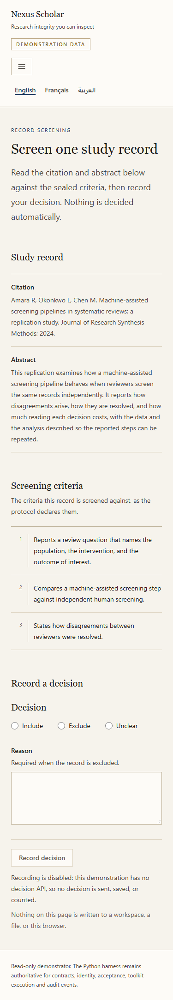

# Nexus Scholar

**A research workspace and toolkit for literature reviews, with source lineage and explicit researcher control over final evidence.**

Nexus helps you define a protocol, discover literature, work through screening and full-text evidence, and keep project artifacts and history together. The intended first user is an individual researcher. Today the released product is a CLI/MCP toolkit; the connected researcher application is under development.

[](https://github.com/nexus-scholar-org/nexus-scholar-harness/actions/workflows/ci.yml)
[](https://pypi.org/project/nexus-scholar/)
[](https://github.com/nexus-scholar-org/nexus-scholar-harness/releases)
[](pyproject.toml)

## What you can use today

The `nexus-scholar` package bundles the harness, eight scientific kits and an MCP server. Initialize a local workspace, inspect its environment, record events and generate configuration for an AI host. Scientific capabilities have different dependencies and acceptance requirements; installation alone does not establish a completed review.

| Surface | Available / intended use | Boundary |
|---|---|---|
| Released CLI/MCP toolkit | Workspace setup and scientific tool access | Follow the versioned user guide and supported tool surfaces |
| Development branch (`main`) | Evidence acceptance, screening integrity and protected publication work | May differ from the installed PyPI release; consult packet evidence |
| Research UI | Screening, overview and workflow demonstrations | Mock-backed scaffold; not a connected production application |
| Individual researcher application | Direct review of sources and recommendations | Product direction, not a completed desktop app or SaaS |

The latest listed release is [v1.0.0](https://github.com/nexus-scholar-org/nexus-scholar-harness/releases/tag/v1.0.0). Later work on `main` is not a claim about that release's behavior.

## Start a workspace

Install [uv](https://docs.astral.sh/uv/getting-started/installation/) and inspect the command surface without checking out the repository:

```sh
uvx nexus-scholar --help
```

For repeated use:

```sh
uv tool install nexus-scholar
# Alternative: pip install nexus-scholar
```

Create a project and inspect its setup:

```sh
nexus-scholar init "UAV crop and weed mapping" --dir ./my-review --scaffold-only
nexus-scholar doctor --workspace ./my-review --exit-code
nexus-scholar setup-mcp --workspace ./my-review --harness all
```

`--scaffold-only` creates a starting workspace with a placeholder protocol; it does not approve criteria or run a search. `doctor` reports setup issues. Additional capability dependencies may need configuration. `setup-mcp` generates configuration; follow the host-specific instructions before using it.

Installed entrypoints are `nexus-scholar` (workspace/setup commands) and `scholar-agent` (MCP server). An external AI host is optional for CLI use and required when using that host as the agent interface.

See the [current user guide](docs/nexus_scholar_user_guide.md) for configuration and troubleshooting, and the [kit surface matrix](docs/kits_surface_matrix.md) for development-source boundaries. Check command help against your installed version; current documentation can describe post-release behavior.

## The researcher workflow we are building

For a crop/weed review, the intended first complete interaction is:

1. Define the question and explicit inclusion/exclusion criteria.
2. Retrieve a bounded literature set and inspect search limitations.
3. Review recommendations alongside their source information.
4. Save unresolved items or override a recommendation without losing its history.
5. Explicitly authorize final decisions and publish the current screening result.
6. Export a screening record with reasons and provenance.

This is the product target, not an end-to-end released demo. AG-04 is developing the worker/review interaction; real UI integration follows. Full-text charting, synthesis and scientific evaluation have separate readiness requirements.

**UI demonstration — mock data:** the existing screening layout illustrates the review direction. It does not demonstrate live data or protected approval.



## Evidence and researcher control

On the supported development paths, Nexus binds accepted artifacts to their parents and exact content. Screening controls reject incomplete coverage, duplicate decisions and unresolved finalization. Agent-control work separates recommendations, review, approval and publication, with generation/currentness checks for named consumers.

These are bounded engineering guarantees. Protected-publisher evidence is for the tested Windows MIC deployment; POSIX enforcement and hosted multi-user deployment are not established. Agent agreement or a critic PASS is not an independent human reference label. Valid provenance is not proof that a scientific conclusion is correct.

Project events use an append-only journal, not protection against an administrator rewriting local files. Model outputs and external-provider results are not universally deterministic. Local storage does not imply local inference: configured services may receive research content.

See the [AG plan](docs/architecture/agent-controls/agent_controls_plan.md), [evidence boundaries](docs/architecture/wp01/evidence-boundaries.md) and [program tracker](docs/UPCOMING_WORK.md) for scope and residual limitations.

## Scientific capabilities and architecture

| Kit | Domain |
|---|---|
| Protocol | Compile and validate research intent/protocols |
| Search | Discovery, deduplication, metadata and screening support |
| PDF | Full-text acquisition and extraction |
| Bibliography | BibTeX parsing, cleaning and resolution |
| RAG | Indexing, retrieval and synthesis capabilities |
| Graph | Citation networks and graph analysis |
| Agent | MCP tool interfaces |
| Verify | Retraction, open-science and methodological trust checks |

Kits own scientific operations. The harness coordinates workspaces, accepted evidence, audit, pipelines and interfaces. CLI, MCP and UI use shared services rather than separate research engines. MCP does not expose every authoritative operation; some acquisition/extraction/index boundaries explicitly refuse unsupported access. A convenience output is not automatically an accepted scientific artifact.

## Develop and contribute

Read [AGENTS.md](AGENTS.md) and the [Developer Compass](docs/architecture/DEVELOPER_COMPASS.md) before implementation. A source checkout has a separate setup path:

```sh
git clone https://github.com/nexus-scholar-org/nexus-scholar-harness.git
cd nexus-scholar-harness
uv sync --extra dev
uv run python scripts/install_plugins.py
```

`uv sync` installs harness dependencies, not all kits. The installer uses the pinned [plugin manifest](.agents/plugins/nexus-scholar/plugins.json). Kit source changes also belong in their canonical repositories with synchronized pins and vendored content.

Contributions go through a fork and PR to this repository. Select checks from the [test-gate policy](docs/architecture/test_gate_policy.md): ordinary prose uses a light gate; consumed documents and executable changes retain required checks. Candidate-specific evidence replaces static test totals. CI badges describe configured checks, not automatic proof that every scientific workflow or the full local pytest suite passed.

Start with the [docs index](docs/README.md), [program tracker](docs/UPCOMING_WORK.md) and [contribution instructions](.agents/skills/pull-request-gate/SKILL.md). For feedback, [open an issue](https://github.com/nexus-scholar-org/nexus-scholar-harness/issues) with your research task, environment and the unclear or failing step.

## License

MIT, as declared in the [project metadata](pyproject.toml).
