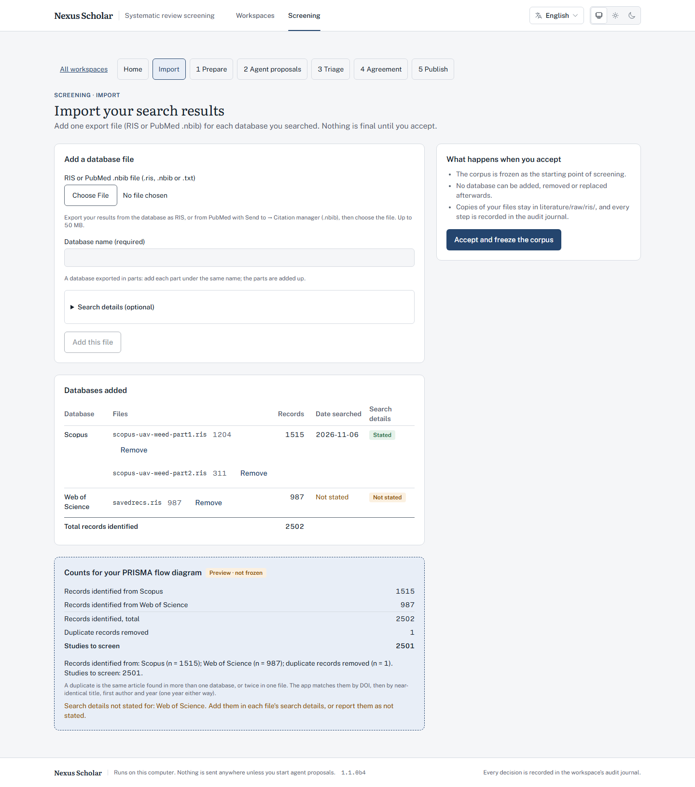

# Nexus Scholar

**A research workspace and toolkit for literature reviews, with source lineage and explicit researcher control over final evidence.**

Nexus helps you define a protocol, discover literature, work through screening and full-text evidence, and keep project artifacts and history together. The intended first user is an individual researcher. Today the released product is the **screening app** (beta). You import your database exports, screen titles and abstracts on your own computer, publish the screening with its PRISMA counts, and export the decisions and a draft methods paragraph. It comes with the CLI/MCP toolkit it is built on.

[](https://github.com/nexus-scholar-org/nexus-scholar-harness/actions/workflows/ci.yml)
[](https://pypi.org/project/nexus-scholar/)
[](https://github.com/nexus-scholar-org/nexus-scholar-harness/releases)
[](pyproject.toml)

## What you can use today

The `nexus-scholar` package bundles the harness, eight scientific kits and an MCP server. Initialize a local workspace, inspect its environment, record events and generate configuration for an AI host. Scientific capabilities have different dependencies and acceptance requirements; installation alone does not establish a completed review.

| Surface | Available / intended use | Boundary |
|---|---|---|
| Screening app (`nexus-scholar ui`), beta | Workspaces, the import of RIS exports with deduplication across databases, title and abstract screening, optional AI drafts, approval, publication, RIS/CSV export, methods paragraph | One reviewer, title and abstract only, RIS only; see the [beta page](docs/beta/README.md) |
| CLI/MCP toolkit | Workspace setup, the same import and screening steps from a terminal, and scientific tool access for an AI host | Follow the versioned user guide and supported tool surfaces |
| Full text, extraction, synthesis, graph, verification | Kits in the package | Parked: not production, labelled so in `--help` |
| Development branch (`main`) | The next beta | May differ from the installed release |

The latest release is the beta [v1.1.0b4](https://github.com/nexus-scholar-org/nexus-scholar-harness/releases/tag/v1.1.0b4) ([release notes](docs/releases/1.1.0b4.md); features in [1.1.0b3](docs/releases/1.1.0b3.md)) (a pre-release, also on PyPI). Later work on `main` is not a claim about that release's behavior.

## Start a workspace

**New here?** [Getting started](docs/getting-started.md) walks you from installing to a published screening and an exported reference list in about 15 minutes. Beta testers: read the [beta page](docs/beta/README.md) first.

Install [uv](https://docs.astral.sh/uv/getting-started/installation/), then Nexus Scholar (the version in the command is needed while it is in beta; do not use `--prerelease allow`, which also takes development releases of other packages), and start the app:

```sh
uv tool install "nexus-scholar>=1.1.0b4"
nexus-scholar --version
nexus-scholar ui
```

`nexus-scholar --version` should print `nexus-scholar 1.1.0b4`. With pip, use `pip install "nexus-scholar>=1.1.0b4"`. The app opens in your browser on **Workspaces**; everything runs on your computer.

From a terminal, create a project and inspect its setup:

```sh
nexus-scholar init "UAV crop and weed mapping" --dir ./my-review --scaffold-only
nexus-scholar doctor --workspace ./my-review --exit-code
nexus-scholar setup-mcp --workspace ./my-review --harness all
```

`--scaffold-only` creates a starting workspace with a placeholder protocol; it does not approve criteria or run a search. `doctor` reports setup issues. Additional capability dependencies may need configuration. `setup-mcp` generates configuration; follow the host-specific instructions before using it.

Installed entrypoints are `nexus-scholar` (workspace/setup commands) and `scholar-agent` (MCP server). An external AI host is optional for CLI use and required when using that host as the agent interface.

See the [current user guide](docs/nexus_scholar_user_guide.md) for configuration and troubleshooting, and the [kit surface matrix](docs/kits_surface_matrix.md) for development-source boundaries. Check command help against your installed version; current documentation can describe post-release behavior.

## The researcher workflow we are building

For a crop/weed review, the intended first complete interaction is:

1. Define the question and explicit inclusion/exclusion criteria.
2. Retrieve a bounded literature set and inspect search limitations.
3. Review recommendations alongside their source information.
4. Save unresolved items or override a recommendation without losing its history.
5. Explicitly authorize final decisions and publish the current screening result.
6. Export a screening record with reasons and provenance.

In the beta, steps 2 to 6 work end to end for title and abstract screening by one reviewer. Search is done in the databases themselves and their RIS exports are imported. The AI drafts are optional, hidden until you decide by default, and never decide for you. Full-text charting, synthesis and scientific evaluation have separate readiness requirements and are parked.



## Evidence and researcher control

On the supported development paths, Nexus binds accepted artifacts to their parents and exact content. Screening controls reject incomplete coverage, duplicate decisions and unresolved finalization. Agent-control work separates recommendations, review, approval and publication, with generation/currentness checks for named consumers.

These are bounded engineering guarantees. Protected-publisher evidence is for the tested Windows MIC deployment; POSIX enforcement and hosted multi-user deployment are not established. Agent agreement or a critic PASS is not an independent human reference label. Valid provenance is not proof that a scientific conclusion is correct.

Project events use an append-only journal, not protection against an administrator rewriting local files. Model outputs and external-provider results are not universally deterministic. Local storage does not imply local inference: configured services may receive research content. [What leaves your computer](docs/data-flow.md) lists every such service, what it receives, and when.

See the [AG record](docs/architecture/agent-controls/README.md), [evidence boundaries](docs/architecture/wp01/evidence-boundaries.md) and [assessment priority list](docs/assessment/README.md) for scope and residual limitations.

## Scientific capabilities and architecture

| Kit | Domain |
|---|---|
| Protocol | Compile and validate research intent/protocols |
| Search | Discovery, deduplication, metadata and screening support |
| PDF | Full-text acquisition and extraction |
| Bibliography | BibTeX parsing, cleaning and resolution |
| RAG | Indexing, retrieval and synthesis capabilities |
| Graph | Citation networks and graph analysis |
| Agent | MCP tool interfaces |
| Verify | Retraction, open-science and methodological trust checks |

Kits own scientific operations. The harness coordinates workspaces, accepted evidence, audit, pipelines and interfaces. CLI, MCP and UI use shared services rather than separate research engines. MCP does not expose every authoritative operation; some acquisition/extraction/index boundaries explicitly refuse unsupported access. A convenience output is not automatically an accepted scientific artifact.

## Develop and contribute

Read [AGENTS.md](AGENTS.md) and the [Developer Compass](docs/architecture/DEVELOPER_COMPASS.md) before implementation. A source checkout has a separate setup path:

```sh
git clone https://github.com/nexus-scholar-org/nexus-scholar-harness.git
cd nexus-scholar-harness
uv sync --extra dev --extra pdf --extra rag
uv run pytest
```

The harness and the seven kits are one package: `uv sync` installs all of them editable from `src/`, with every CLI. Kit code is changed in `src/scholar_<kit>/` like any other code, in one PR.

Contributions go through a fork and PR to this repository. Select checks from the [test-gate policy](docs/architecture/test_gate_policy.md): ordinary prose uses a light gate; consumed documents and executable changes retain required checks. Candidate-specific evidence replaces static test totals. CI badges describe configured checks, not automatic proof that every scientific workflow or the full local pytest suite passed.

Start with the [docs index](docs/README.md), [assessment priority list](docs/assessment/README.md) and [contribution instructions](.agents/skills/pull-request-gate/SKILL.md). For feedback, [open an issue](https://github.com/nexus-scholar-org/nexus-scholar-harness/issues) with your research task, environment and the unclear or failing step.

## License

MIT; see [LICENSE](LICENSE).
