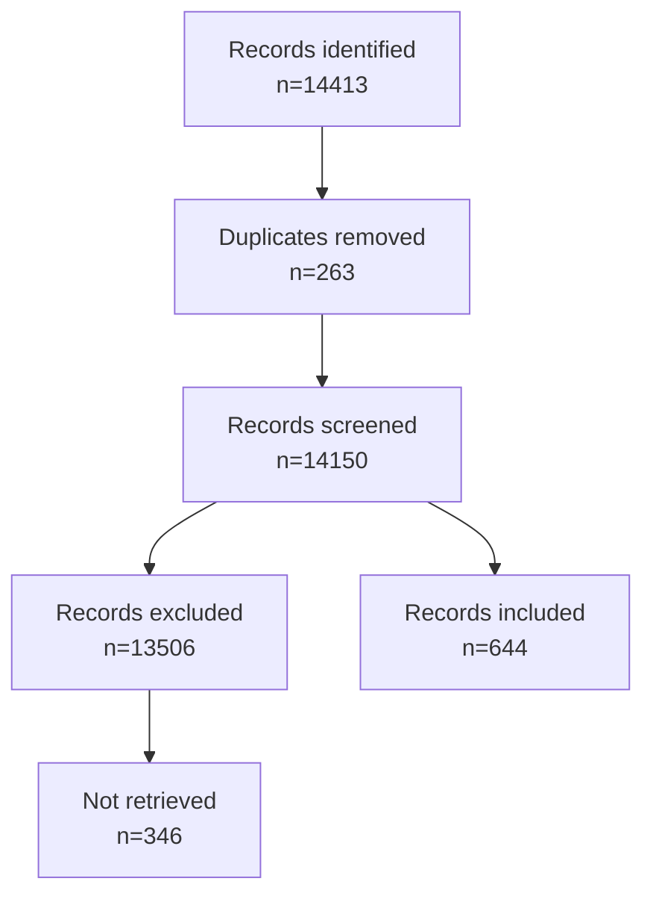

# PRISMA-ScR screening report — UAV crop-weed mapping (protocol v0.3)

**Status:** FINAL AGENT DECISIONS, **NOT HUMAN-CONFIRMED**.
Protocol fingerprint `sha256:f81e6c58…f755`; criteria `9ae1f97d…b86f`.

## Counts

| Stage | n |
|---|---:|
| Identified | 14413 |
| Duplicates removed | 263 |
| Screened | 14150 |
| Excluded | 13506 |
| — of which not retrieved (no usable abstract) | 346 |
| Included | 644 |

## Exclusion reasons

| Code | n |
|---|---:|
| BOUNDARY_AMBIGUOUS_PLATFORM | 4 |
| MODERATION_TITLE_ONLY_EXCLUDE | 145 |
| NO_USABLE_ABSTRACT_NOT_RETRIEVED | 346 |
| OUTSIDE_DATE_LANGUAGE | 103 |
| OUT_OF_SCOPE | 9 |
| UNSPECIFIED | 1 |
| WRONG_PLATFORM | 757 |
| WRONG_REPORT_TYPE | 888 |
| WRONG_TASK | 11253 |

## Lane provenance

| Lane | INCLUDE | EXCLUDE |
|---|---:|---:|
| mutual_include | 588 | 0 |
| third_lane | 40 | 641 |
| pass2 | 16 | 162 |
| mutual_exclude | 0 | 12357 |
| not_retrieved | 0 | 346 |

## Limitations

- All decisions were produced by **agents** (`FINAL_AGENT_UNCONFIRMED` provenance). `HumanConfirmation@1` was signed on 2026-10-31 by **Mouadh BEKHOUCHE** (PhD student, University of Oum El Bouaghi, lead_reviewer) over all 283 decision artifacts / 14,150 decisions; record: `literature/screening/HUMAN_CONFIRMATION.json`. The signer is the researcher: this records reviewed acceptance, not independent third-party review.
- DEV-01: records lacking a usable abstract are excluded as *not retrieved* per a delegated researcher instruction; this deviates from INC-02/EXC-03 and is reported above rather than hidden in the exclusion total.
- Search coverage is bounded by the recorded provider wall (Semantic Scholar HTTP 429); the corpus is the r3d union (14,413 records, 14,150 after dedup).
- Charting is frozen with limitation F1 and produced no accepted rows.

## Artifacts

- `literature/included.json`, `literature/excluded.json`
- `literature/screening/final_decisions.json`, `literature/screening/summary.json`
- `literature/prisma_report.json`, this report
